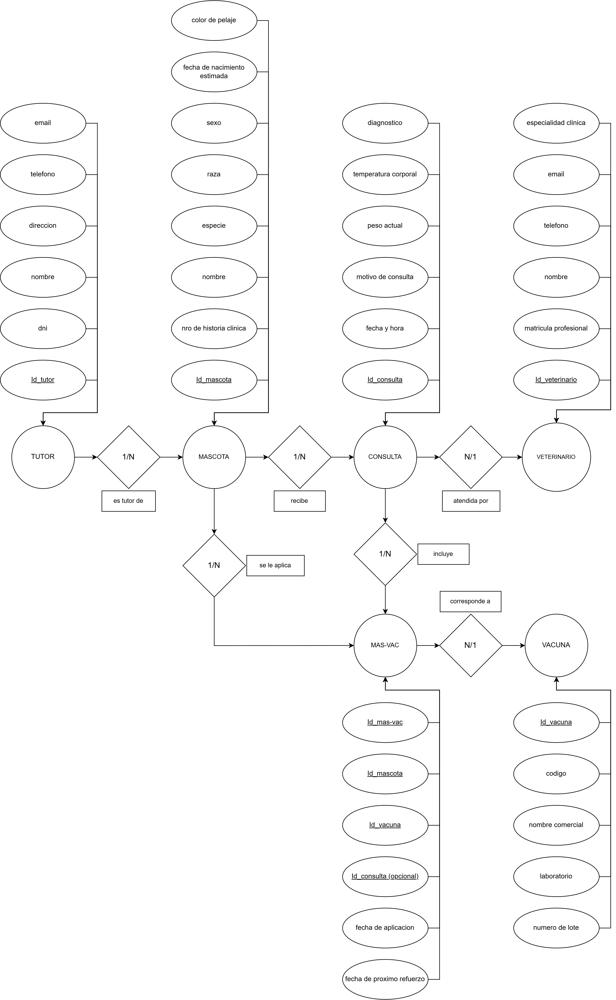

# BASE DE DATOS — Ejercicio 17: Sistema de Historia Clínica Veterinaria para Pequeños Animales

Trabajo práctico de Base de Datos (Universidad Champagnat). Este repositorio contiene todo el desarrollo del ejercicio 17: modelo entidad-relación, modelo relacional y normalización (1FN, 2FN y 3FN).

## Consigna


#### Contexto

Una clínica veterinaria integral necesita informatizar la atención médica de pacientes animales (caninos, felinos, exóticos), el control de vacunas y desparasitaciones, la programación de cirugías y la dispensación de tratamientos farmacológicos.


#### Consigna

Diseñar el modelo entidad-relación para la clínica veterinaria cumpliendo con las siguientes especificaciones:

Los clientes (tutores o dueños de las mascotas) se identifican por su DNI, nombre, dirección y teléfono de contacto. Un tutor puede ser dueño de múltiples mascotas.

Las mascotas (pacientes) poseen un número de historia clínica único, nombre, especie, raza, sexo, fecha de nacimiento estimada y color de pelaje. Cada mascota pertenece obligatoriamente a un único tutor.

Los veterinarios de la clínica se identifican por su matrícula profesional, nombre, teléfono y especialidad clínica (ej. Cirugía, Dermatología, Clínica Médica General).

Las consultas veterinarias registran la fecha y hora de atención, motivo de consulta, peso actual del animal, temperatura corporal, diagnóstico presuntivo o definitivo y el veterinario actuante.

En el transcurso de una consulta o de manera preventiva, se aplican vacunas. De cada vacuna se registra su código, nombre comercial, laboratorio y número de lote. Se debe asociar la aplicación de la vacuna a la mascota, indicando la fecha de aplicación y la fecha sugerida para el próximo refuerzo.


#### Desarrollo requerido


Modelar la relación 1:N entre Tutor y Mascota (paciente).

Establecer la relación entre Mascota y Consulta Veterinaria, vinculando a su vez al Veterinario responsable.

Diseñar la entidad Vacuna y su relación N:M (o registro de aplicación) con la Mascota, incorporando los atributos de control temporal de refuerzos.

Garantizar la integridad referencial para que el historial clínico mantenga la trazabilidad de por vida de cada animal.

## Estructura del repositorio

```
BASE_DE_DATOS_Ejercicio_17/
├── README.md
├── modelo-er/
│   ├── ejercicio_17.drawio        # diagrama editable (draw.io)
│   └── ejercicio_17.png           # exportación del diagrama
├── modelo-relacional/
│   ├── ejercicio_17_MR.xlsx               # modelo relacional
│   └── ejercicio_17_con_datos.xlsx        # modelo relacional con datos de ejemplo
└── normalizacion/
    ├── ejercicio_17_1FN.xlsx
    ├── ejercicio_17_2FN.xlsx
    └── ejercicio_17_3FN.xlsx
```

## Modelo entidad-relación



Archivo editable: [`modelo-er/ejercicio_17.drawio`](modelo-er/ejercicio_17.drawio).

## Modelo relacional

Tablas del modelo relacional original, antes de normalizar (`(PK)` clave primaria, `(FK)` clave foránea, `(UNIQUE)` valor único):

- **TUTOR**: `Id_tutor(PK)`, `dni(UNIQUE)`, `nombre`, `direccion`, `telefono`, `email`
- **MASCOTA**: `Id_mascota(PK)`, `nro de historia clinica(UNIQUE)`, `nombre`, `especie`, `raza`, `sexo`, `fecha de nacimiento estimada`, `color de pelaje`, `Id_tutor(FK)`
- **VETERINARIO**: `Id_veterinario(PK)`, `matricula profesional(UNIQUE)`, `nombre`, `telefono`, `email`, `especialidad clinica`
- **CONSULTA**: `Id_consulta(PK)`, `fecha y hora`, `motivo de consulta`, `peso actual`, `temperatura corporal`, `diagnostico`, `Id_mascota(FK)`, `Id_veterinario(FK)`
- **VACUNA**: `Id_vacuna(PK)`, `codigo(UNIQUE)`, `nombre comercial`, `laboratorio`, `numero de lote`
- **MAS-VAC**: `Id_mas-vac(PK)`, `Id_mascota(FK,PK)`, `Id_vacuna(FK,PK)`, `Id_consulta (opcional)(FK)`, `fecha de aplicacion`, `fecha de proximo refuerzo`

Archivos: [`ejercicio_17_MR.xlsx`](modelo-relacional/ejercicio_17_MR.xlsx) y [`ejercicio_17_con_datos.xlsx`](modelo-relacional/ejercicio_17_con_datos.xlsx).

## Lógica relacional

Cada entidad se convierte en una tabla con su clave primaria. Las relaciones se representan así:

- **1:N / N:1**: la clave primaria del lado "uno" se copia como clave foránea (FK) en la tabla del lado "muchos".
- **1:1**: igual que 1:N, pero la FK lleva restricción UNIQUE.
- **N:M**: se crea una tabla intermedia cuyas FK forman una clave compuesta, junto con una clave propia que se identifica por esa combinación.

Relaciones del modelo final (3FN):

- `MASCOTA` → `RAZA`: **N:1** (FK `id_raza` en `MASCOTA`).
- `MASCOTA` → `TUTOR`: **N:1** (FK `id_tutor` en `MASCOTA`).
- `CONSULTA` → `MASCOTA`: **N:1** (FK `id_mascota` en `CONSULTA`).
- `CONSULTA` → `VETERINARIO`: **N:1** (FK `id_veterinario` en `CONSULTA`).
- `MASCOTA` ↔ `VACUNA`: relación **N:M**, resuelta con la tabla intermedia `MAS-VAC` (sus FK forman la clave compuesta única).

## Normalización

Los cambios se muestran etapa por etapa; cada etapa parte del resultado de la anterior.

### Primera forma normal (1FN)

- `TUTOR`: se quitan `direccion`
- `TUTOR`: se agregan `calle`, `numero`, `ciudad`

### Segunda forma normal (2FN)

Sin cambios respecto de la etapa anterior: el modelo ya cumplía esta forma normal.

### Tercera forma normal (3FN)

- Tablas nuevas: `RAZA`
- `MASCOTA`: se quitan `especie`, `raza`
- `MASCOTA`: se agregan `id_raza`

#### Modelo final en 3FN

- **TUTOR**: `Id_tutor(PK)`, `dni(UNIQUE)`, `nombre`, `calle`, `numero`, `ciudad`, `telefono`, `email`
- **MASCOTA**: `Id_mascota(PK)`, `nro de historia clinica(UNIQUE)`, `nombre`, `Id_raza(FK)`, `sexo`, `fecha de nacimiento estimada`, `color de pelaje`, `Id_tutor(FK)`
- **RAZA**: `Id_raza(PK)`, `raza(UNIQUE)`, `especie`
- **VETERINARIO**: `Id_veterinario(PK)`, `matricula profesional(UNIQUE)`, `nombre`, `telefono`, `email`, `especialidad clinica`
- **CONSULTA**: `Id_consulta(PK)`, `fecha y hora`, `motivo de consulta`, `peso actual`, `temperatura corporal`, `diagnostico`, `Id_mascota(FK)`, `Id_veterinario(FK)`
- **VACUNA**: `Id_vacuna(PK)`, `codigo(UNIQUE)`, `nombre comercial`, `laboratorio`, `numero de lote`
- **MAS-VAC**: `Id_mas-vac(PK)`, `Id_mascota(FK,PK)`, `Id_vacuna(FK,PK)`, `Id_consulta (opcional)(FK)`, `fecha de aplicacion`, `fecha de proximo refuerzo`

Archivos: [`ejercicio_17_1FN.xlsx`](normalizacion/ejercicio_17_1FN.xlsx), [`ejercicio_17_2FN.xlsx`](normalizacion/ejercicio_17_2FN.xlsx), [`ejercicio_17_3FN.xlsx`](normalizacion/ejercicio_17_3FN.xlsx).
